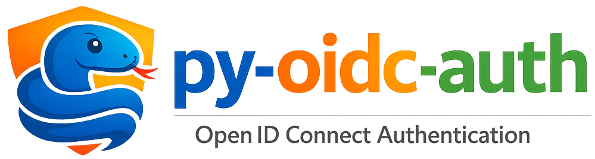
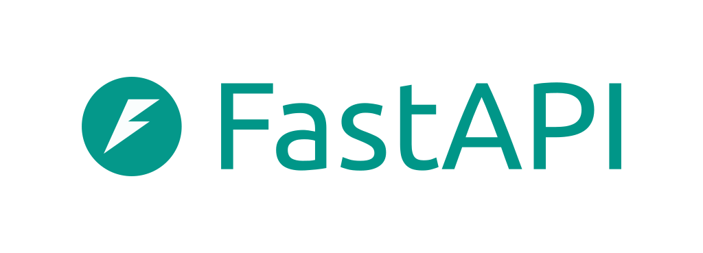

<p align="center">
  
</p>
<p align="center">
<em>A small, typed OpenID Connect helper for authentication and authorization.</em>
</p>

[](LICENSE)
[](https://codecov.io/gh/freva-org/py-oidc-auth)
[](https://py-oidc-auth.readthedocs.io/en/latest/?badge=latest)
[](https://pypi.org/project/py-oidc-auth)
[](https://pypi.org/project/py-oidc-auth/)

It provides

* a framework independent async core: `OIDCAuth`
* framework adapters that expose common auth endpoints
* simple `required()` and `optional()` helpers to protect routes
* token minting/brokering and token federation

## What it does

`py-oidc-auth` adds OpenID Connect authentication to your Python web application. You create one auth instance at app startup, get a pre-built router (or blueprint / URL patterns), optionally add your own custom routes to it, and include it in your app. Protected routes use `required()` and `optional()` helpers.

## Supported frameworks
<table align="center">
  <tr>
    <td align="center" width="180">
      <a href="https://fastapi.tiangolo.com/" title="FastAPI">
        
      </a><br>
      <sub>FastAPI</sub>
    </td>
    <td align="center" width="180">
      <a href="https://flask.palletsprojects.com/" title="Flask">
        
      </a><br>
      <sub>Flask</sub>
    </td>
    <td align="center" width="180">
      <a href="https://quart.palletsprojects.com/" title="Quart">
        
      </a><br>
      <sub>Quart</sub>
    </td>
  </tr>
  <tr>
    <td align="center" width="180">
      <a href="https://www.tornadoweb.org/" title="Tornado">
        
      </a><br>
      <sub>Tornado</sub>
    </td>
    <td align="center" width="180">
      <a href="https://litestar.dev/" title="Litestar">
        
      </a><br>
      <sub>Litestar</sub>
    </td>
    <td align="center" width="180">
      <a href="https://www.djangoproject.com/" title="Django">
        
      </a><br>
      <sub>Django</sub>
    </td>
  </tr>
</table>

## Features

* Authorization code flow with client side PKCE (and a legacy server side mode)
* Refresh token flow
* Device authorization flow
* Userinfo lookup
* Provider initiated logout (end session) when supported
* Bearer token validation using provider JWKS, issuer, and audience
* Optional scope checks and simple claim constraints
* Full type annotation 🏷️

## Install

Pick your framework for installation with pip:

```console
python -m pip install py-oidc-auth[fastapi]
python -m pip install py-oidc-auth[flask]
python -m pip install py-oidc-auth[quart]
python -m pip install py-oidc-auth[tornado]
python -m pip install py-oidc-auth[litestar]
python -m pip install py-oidc-auth[django]
```

Or use conda/mamba/micromamba:

```console
conda install -c conda-forge py-oidc-auth-fastapi
conda install -c conda-forge py-oidc-auth-flask
conda install -c conda-forge py-oidc-auth-quart
conda install -c conda-forge py-oidc-auth-tornado
conda install -c conda-forge py-oidc-auth-litestar
conda install -c conda-forge py-oidc-auth-django
```

Import name is `py_oidc_auth`:

```python
from py_oidc_auth import OIDCAuth
```

## Concepts

### Core

`OIDCAuth` is the framework independent client. It loads provider metadata from the
OpenID Connect discovery document, performs provider calls, and validates tokens.

### Adapters

Each adapter subclasses `OIDCAuth` and adds:

* helpers to register the standard endpoints (router, blueprint, urlpatterns, etc.)
* `required()` and `optional()` helpers to validate bearer tokens on protected routes

## Default endpoints

Adapters can expose these paths (customizable and individually disabled):

* `GET  /auth/v2/login`
* `GET  /auth/v2/callback`
* `POST /auth/v2/token`
* `POST /auth/v2/device`
* `GET  /auth/v2/logout`
* `GET  /auth/v2/userinfo`
* `GET  /auth/v2/.well-known/jwks.json`

## PKCE, state and logout

Clients should keep their PKCE verifier to themselves. Make a verifier,
send only its S256 challenge and your own `state` to the login endpoint,
let the provider redirect to your own callback, check `state` there and
redeem the code at the token endpoint with the verifier:

```text
GET  /auth/v2/login?redirect_uri=http://localhost:53100/callback
     &code_challenge=<base64url(sha256(verifier)), no padding>&state=<random>
...  browser comes back to http://localhost:53100/callback?code=...&state=...
POST /auth/v2/token   code=...&redirect_uri=...&code_verifier=<verifier>
```

The device flow works the same way: send `code_challenge` to
`POST /auth/v2/device` and `code_verifier` with every poll of the token
endpoint. Keycloak (25 and later) then refuses the device code without the
verifier.

A login without `code_challenge` still works: the server makes the verifier
and carries it, with the redirect URI, in `state` for `/auth/v2/callback`.
That gives no PKCE protection (whoever sees the redirect sees code and
verifier together) and logs a warning. Once your clients send challenges,
set `require_client_pkce=True` to refuse such logins and device flows, to
refuse codes and device codes redeemed without `code_verifier` and to
disable `/auth/v2/callback`. Also set the provider client to require S256
(in Keycloak: client, Advanced, "Proof Key for Code Exchange Code Challenge
Method"), so that codes obtained from the provider directly need a
verifier too.

Token responses carry the provider's `id_token` (not in broker mode). Pass
it to `GET /auth/v2/logout?id_token_hint=...` so the provider ends the
session without asking the user to confirm.

The token endpoint takes `refresh_token` and `device_code`; the older
`refresh-token` and `device-code` still work. When the provider cannot be
reached, the endpoints answer 503; when its discovery URL answers but gives
no discovery document (a wrong URL or realm), they answer 502 with the
reason.

## Quick start

Create one auth instance at app startup:

```python
auth = ...(
    client_id="my client",
    client_secret="secret",
    discovery_url="https://idp.example.org/realms/demo/.well-known/openid-configuration",
    scopes="myscope profile email",
    audience="my-aud",
    broker_mode=True,
    broker_store_url="postgresql+asyncpg://user:pw@db/myapp",
    broker_audience="myapp-api",
    trusted_issuers=["https://other-instance.example.org"],
)
```

### FastAPI

```python
from typing import Dict, Optional

from fastapi import FastAPI
from py_oidc_auth import FastApiOIDCAuth, IDToken

app = FastAPI()

auth = FastApiOIDCAuth(
    client_id="my client",
    client_secret="secret",
    discovery_url="https://idp.example.org/realms/demo/.well-known/openid-configuration",
    scopes="myscope profile email",
    audience="my-aud",
    broker_mode=True,
    broker_store_url="postgresql+asyncpg://user:pw@db/myapp",
    broker_audience="myapp-api",
    trusted_issuers=["https://other-instance.example.org"],
)

app.include_router(auth.create_auth_router(prefix="/api"))

@app.get("/me")
async def me(token: IDToken = auth.required()) -> Dict[str, str]:
    return {"sub": token.sub}

@app.get("/feed")
async def feed(token: Optional[IDToken] = auth.optional() -> Dict[str, str]:
    if token is None:
       message = "Welcome guest"
    else:
       message = "Welcome back, {token.given_name}"
    return {"message": message}
```

### Flask

```python
from flask import Flask, Response, jsonify
from py_oidc_auth import FlaskOIDCAuth

app = Flask(__name__)

auth = FlaskOIDCAuth(
    client_id="my client",
    client_secret="secret",
    discovery_url="https://idp.example.org/realms/demo/.well-known/openid-configuration",
    scopes="myscope profile email",
    audience="my-aud",
    broker_mode=True,
    broker_store_url="postgresql+asyncpg://user:pw@db/myapp",
    broker_audience="myapp-api",
    trusted_issuers=["https://other-instance.example.org"],
)

app.register_blueprint(auth.create_auth_blueprint(prefix="/api"))

@app.get("/protected")
@auth.required()
def protected(token: IDToken) -> Response:
    return jsonify({"sub": token.sub})
```

### Quart

```python
from quart import Quart, Response, jsonify
from py_oidc_auth import QuartOIDCAuth, IDToken

app = Quart(__name__)

auth = QuartOIDCAuth(
    client_id="my client",
    client_secret="secret",
    discovery_url="https://idp.example.org/realms/demo/.well-known/openid-configuration",
    scopes="myscope profile email",
    audience="my-aud",
    broker_mode=True,
    broker_store_url="postgresql+asyncpg://user:pw@db/myapp",
    broker_audience="myapp-api",
    trusted_issuers=["https://other-instance.example.org"],
)

app.register_blueprint(auth.create_auth_blueprint(prefix="/api"))

@app.get("/protected")
@auth.required()
async def protected(token: IDToken) -> Response:
    return jsonify({"sub": token.sub})
```

### Django

Decorator style:

```python
from django.http import HttpRequest, JsonResponse
from django.urls import include, path
from py_oidc_auth import DjangoOIDCAuth, IDToken

auth = DjangoOIDCAuth(
    client_id="my client",
    client_secret="secret",
    discovery_url="https://idp.example.org/realms/demo/.well-known/openid-configuration",
    scopes="myscope profile email",
    audience="my-aud",
    broker_mode=True,
    broker_store_url="postgresql+asyncpg://user:pw@db/myapp",
    broker_audience="myapp-api",
    trusted_issuers=["https://other-instance.example.org"],
)

@auth.required()
async def protected_view(request: HttpRequest, token: IDToken) -> JsonResponse:
    return JsonResponse({"sub": token.sub})

urlpatterns = [
    path("api/", include(auth.get_urlpatterns())),
    path("protected/", protected_view),
]
```

Routes only:

```python
urlpatterns = [
    *auth.get_urlpatterns(prefix="api"),
    path("api/", include(...))
]
```

### Tornado

```python
import json
import tornado.web
from py_oidc_auth import TornadoOIDCAuth, IDToken

auth = TornadoOIDCAuth(
    client_id="my client",
    client_secret="secret",
    discovery_url="https://idp.example.org/realms/demo/.well-known/openid-configuration",
    scopes="myscope profile email",
    audience="my-aud",
    broker_mode=True,
    broker_store_url="postgresql+asyncpg://user:pw@db/myapp",
    broker_audience="myapp-api",
    trusted_issuers=["https://other-instance.example.org"],
)

class ProtectedHandler(tornado.web.RequestHandler):
    @auth.required()
    async def get(self, token: IDToken) -> None:
        self.write(json.dumps({"sub": token.sub}))

def make_app():
    return tornado.web.Application(
        auth.get_auth_routes(prefix="/api") + [
            (r"/protected", ProtectedHandler),
        ]
    )
```

### Litestar

```python
from typing import Dict
from litestar import Litestar, get
from litestar.di import NamedDependency
from py_oidc_auth import IDToken, LitestarOIDCAuth

auth = LitestarOIDCAuth(
    client_id="my client",
    client_secret="secret",
    discovery_url="https://idp.example.org/realms/demo/.well-known/openid-configuration",
    scopes="myscope profile email",
    audience="my-aud",
    broker_mode=True,
    broker_store_url="postgresql+asyncpg://user:pw@db/myapp",
    broker_audience="myapp-api",
    trusted_issuers=["https://other-instance.example.org"],
)

@get("/protected", dependencies={"token": auth.required()})
async def protected(token: NamedDependency[IDToken]) -> Dict[str, str]:
    return {"sub": token.sub}

app = Litestar(
    route_handlers=[
        protected,
        auth.create_auth_router(prefix="/api"),
    ]
)
```

## Scopes audience and claim constraints

All adapters support:

* `scopes="a b c"` to require scopes on a protected endpoint
* `claims={...}` to enforce simple claim constraints
* `audience=my-aud` to enforce intended audience check

FastApi Example:

```python
@auth.required(scopes="admin", claims={"groups": ["admins"]})
def admin(token: IDToken) -> Dict[str, str]:
    return {"sub": token.sub}
```

Scope checks also apply in broker mode, where broker tokens carry the scope the
Identity Provider granted.

Clients may ask for fewer scopes at login (`/login?scope=...`), but only narrow
the configured ones: every requested scope must be in `scopes`, `openid`,
`offline_access` or `allowed_scopes`, otherwise the request is refused (400,
`invalid_scope`). The Identity Provider still decides what it grants: Keycloak
always adds a client's *default* client scopes, so a request can only leave out
*optional* ones.


## Token minting and federation
The `broker_mode=True` option allows for the creation of minting of application
specific tokens rather than passing tokens from the Identity Provider.

Token minting also allows for token federation where multiple applications can
be configured to trust each others tokens.

## Related

* **[py-oidc-auth-client](https://pypi.org/project/py-oidc-auth-client/)** — typed Python client for authenticating against services that expose py-oidc-auth-compatible routes.


## Development
Development runs through [just](https://just.systems) and containers
(Docker or Podman); you do not need Python installed locally:

```console
just dev litestar     # Keycloak plus a litestar test app on http://localhost:7777
just test             # the test suite, in a container
PY=3.11 just test     # on another Python version
just check            # lint, types and tests
```

Run `just` for all recipes.

## Contributing
See the [CONTRIBUTING.md](CONTRIBUTING.md) document to get involved.
